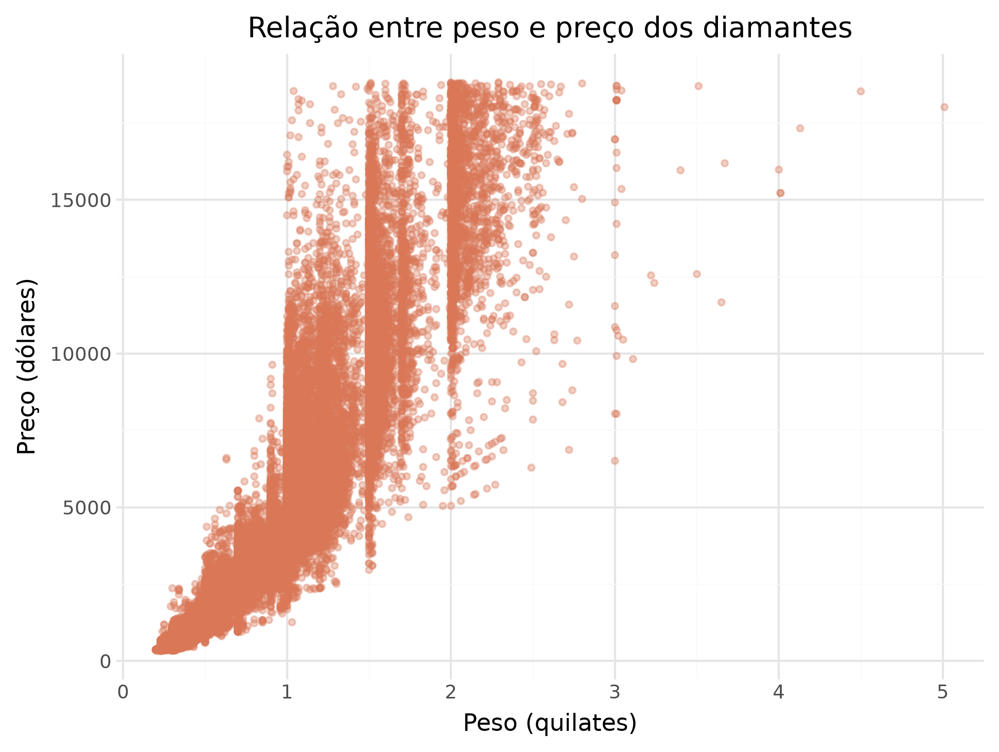
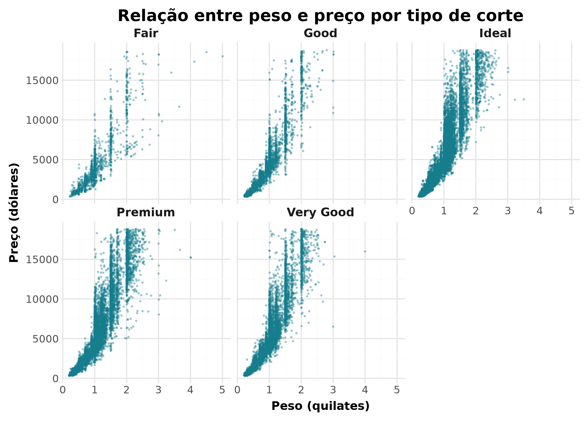
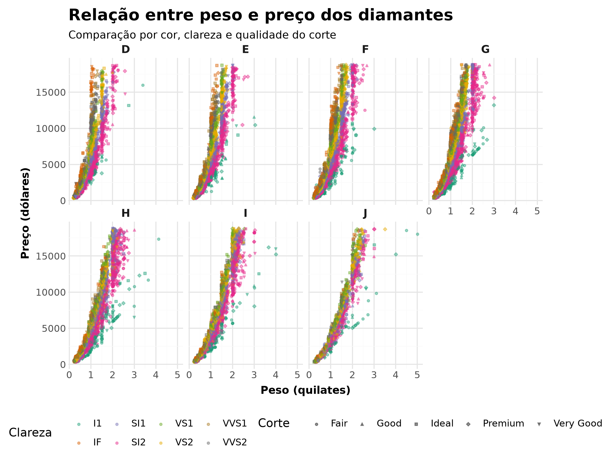

##  Visualização de Dados com plotnine

```{r}
library(reticulate)
py_require(c("numpy", "polars", "plotnine", "pyarrow"))
```

```{python}
import polars as pl
#print(pl.__version__)
```


# Atividades
1.  Importe o conjunto de dados diamonds, cujo arquivo está disponível no website da disciplina.
```{python}

from plotnine import *

diamonds = pl.read_csv("../diamonds.csv.gz")
print(diamonds)
```

```{python}
print(diamonds.head())
print(diamonds.schema)
```

2.  Crie uma visualização de dados que descreva a associação existente entre as variáveis peso (carat) e preço (price). Que ações você tomou para garantir que você produziu um gráfico de boa qualidade? Escreva um parágrafo comunicando os seus achados.
```{python}
import polars as pl
from plotnine import ggplot, aes, geom_point, labs, theme_minimal


diamonds_pd = diamonds.to_pandas()

grafico = (
    ggplot(diamonds_pd, aes(x="carat", y="price"))
    + geom_point(color = "#D97757", alpha=0.35, size=1.2)
    + labs(
        title="Relação entre peso e preço dos diamantes",
        x="Peso (quilates)",
        y="Preço (dólares)"
    )
    + theme_minimal()
)


figura = grafico.draw()
figura.savefig("grafico.png", dpi=300, bbox_inches="tight")
```
```{r}

```


Resposta: Para duas variáveis numéricas que, a princípio, não sabemos se tem relação linear (o preço depende não só do peso, mas também da qualidade do diamante), a opção pelo grafico de dispersão relaciona as variáveis e permite ao observador verificar se há correlação entre elas.E como cada ponto é um diamante do banco de dados, é possível também observar como os preços variam com diamantes com pesos semelhantes. O gráfico pode ser considerado uma boa opção pela clareza das informações. Ele exemplifica uma associação positiva entre as variáveis e a dispersão do preço em relação ao peso de cada diamante.


3.  A relação identificada na questão anterior é a mesma relação presente nos diferentes cortes de diamantes? Crie uma visualização que demonstre seus achados eficientemente. Descreva sua conclusão em um parágrafo.

```{python}
from plotnine import (
    ggplot, aes, geom_point, labs,
    facet_wrap, theme_minimal, theme, element_text
)

grafico_cortes = (
    ggplot(diamonds_pd, aes(x="carat", y="price"))
    + geom_point(color="#167D8D", alpha=0.3, size=0.2)
    + facet_wrap("~cut", ncol=3)
    + labs(
        title="Relação entre peso e preço por tipo de corte",
        x="Peso (quilates)",
        y="Preço (dólares)"
    )
    + theme_minimal()
    + theme(
        figure_size=(10, 7),
        plot_title=element_text(size=14, weight="bold"),
        axis_title=element_text(size=10, weight="bold"),
        strip_text=element_text(size=10, weight="bold")
    )
)

figura2 = grafico_cortes.draw()
figura2.set_size_inches(7, 5)
figura2.savefig("grafico_cortes.png", dpi=300, bbox_inches="tight")

```
```{r}

```

Resposta: Sim, se agrupados por tipos de cortes a relação entre o peso e o preço dos diamantes continuam positivamente relacionados. O qu eobservamos apenas é que alguns tipos de cortes tem uma quantidade maior de diamantes mais leves do que outros cortes, como por exemplo, se compararmos o corte Fair com o corte Premium, mas todos eles tendem a custar mais se o peso é maior.


4.  Crie uma visualização que mostre a relação entre preço e peso do diamante, considerando as diferentes combinações de qualidade de corte, cor e clareza do diamante. Quais foram as dificuldades encontradas? A relação entre preço e peso é a mesma para diferentes configurações de diamantes?

```{python}
from plotnine import (
    ggplot, aes, geom_point, labs,
    facet_wrap, theme_minimal, theme, element_text,
    scale_color_brewer
)

grafico_qualidade = (
    ggplot(
        diamonds_pd,
        aes(
            x="carat",
            y="price",
            color="clarity",
            shape="cut"
        )
    )
    + geom_point(alpha=0.4, size=0.8)
    + facet_wrap("~color", ncol=4)
    + scale_color_brewer(type="qual", palette="Dark2")
    + labs(
        title="Relação entre peso e preço dos diamantes",
        subtitle="Comparação por cor, clareza e qualidade do corte",
        x="Peso (quilates)",
        y="Preço (dólares)",
        color="Clareza",
        shape="Corte"
    )
    + theme_minimal()
    + theme(
        figure_size=(12, 9),
        plot_title=element_text(size=15, weight="bold"),
        plot_subtitle=element_text(size=10),
        axis_title=element_text(size=10, weight="bold"),
        strip_text=element_text(size=10, weight="bold"),
        legend_position="bottom"
    )
)

figura3 = grafico_qualidade.draw()
figura3.set_size_inches(7, 6)
figura3.savefig("grafico_qualidade.png", dpi=300, bbox_inches="tight")

```
```{r}

```

Resposta: A vizualização fica pouco clara quando queremos mostrar todos esses recortes, a relação entre peso e preço continua positivamente correlacionada, porém os recursos visuais existentes não são suficientes para que o observador distinga as características de clareza e corte. 


```{r}
Sys.setenv(TZ = "America/Sao_Paulo")

paste(
  "Arquivo compilado em:",
  format(Sys.time(), "%d/%m/%Y às %H:%M:%S")
)
```